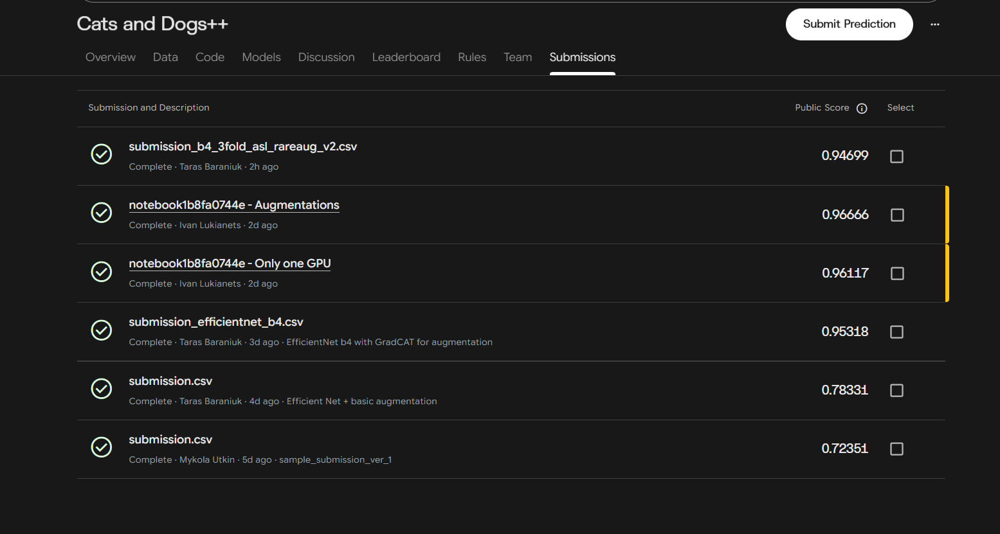

# AI301 Assignment #2: Convolutional Neural Networks - Kaggle "Cats and Dogs++"

**Task.** Multi-label classification of photos with 5 binary labels: `Cat`, `Dog` and three identity classes of one owner's pets,
`Moris` (black long-haired cat), `Motya` (calico cat), `Biatrix` (corgi). Photos with none of these are "background" and have all zeros.
**Metric:** macro F1 over the 5 labels, so each class is worth 20%. The three rare identity classes are **60% of the score** but have only 41-56 train photos each.

---

## 0. Summary

| | |
|---|---|
| Final model | TODO (run whole model / soft-voting ensemble) |
| Backbone | EfficientNet-B4 (timm, ImageNet-1k); ConvNeXt-Tiny (timm, ImageNet-22k->1k) as the second backbone |
| What mattered most | cleaning the labels and **splitting validation by scene** (shortcut control), a **cut-and-paste augmentation of the rare pets**, per-class thresholds + the species rule |
| Custom building block | class-specific attention pooling head |
| Ensemble | soft voting of the EfficientNet and ConvNeXt runs |
| Public LB | 0.9666 |

All experiments with **CV and LB** are present.

---

## EDA & Metrics Analysis

| Finding | Numbers |
|---|---|
| Size | train 12,260 / test 18,673; **every image is 450×375** |
| Imbalance | Cat 41.4%, Dog 41.0%, **Moris 56, Motya 42, Biatrix 41** positives (0.33-0.46%) |
| Background | 17.6% (2,162) train images have no label: other animals (insects, birds, sea life), not empty scenes |
| Hierarchy | Moris/Motya always come with Cat, Biatrix always with Dog (100% of train); Cat+Dog together in only 4 images |
| Rare classes | one owner's phone photos at home, **often small and far away** (snow, grass); several shots of the same scene |
| Train vs test | brightness / contrast / saturation / sharpness distributions match (means differ by < 0.01) |
| Odd images | ~1% grayscale, ~0.3-0.5% very dark, ~0.8% very bright in **both** sets; 1 blank white test image |
| Near-duplicates (pHash) | train-train 162 pairs, train-test 430, test-test 302; max group size 2; **0 label conflicts** |
| Label noise | found by a rare-class review and an ImageNet-classifier label check (section 3) |

What these facts decided:
1. **Macro F1 makes the rare classes the score.** One missed or false rare prediction moves the score far more than many Cat/Dog errors -> one threshold per class, plus the species rule.
2. **All rare photos come from one place**, so a CNN can learn "this sofa / this snow field" instead of "this cat" (**shortcut learning**) -> grouped validation and a background-changing augmentation.
3. **No train-test shift in quality** -> augmentations regularise, they do not have to correct a shift.
4. **Train-test duplicates (2.3% of test)** mean the leaderboard partly rewards memorisation.

---

## Data preparation (`EDA.ipynb` -> `train_clean.csv`)

1. **Label check with an ImageNet classifier.** `convnext_base.fb_in22k_ft_in1k` (timm, allowed) scored every train image:
   `p_cat` = summed probability of the 5 domestic-cat classes, `p_dog` = summed probability of the 118 dog breeds. It **only proposed candidates.
   Every candidate was checked by eye**, nothing was relabelled automatically.

   | Check | Candidates | Confirmed |
   |---|---|---|
   | Cat label, no cat found (`p_cat < 0.1`) | 302 | 5 |
   | Dog label, no dog found (`p_dog < 0.1`) | 15 | 5 |
   | No Dog label, dog found (`p_dog > 0.9`) | 6 | 2 |

   Most of the 302 were false alarms (small or hidden cats that ImageNet names as a basket or sink; black long-haired cats called schipperke). That is why a human decided.
   Final result: **12 label fixes** (10 from the ImageNet check, 2 from the rare-class review) and **1 unusable image dropped**. The competition owner confirmed that fixing train labels is allowed; test is never touched.
2. **Deduplication of train.** 64-bit pHash with a tight threshold. One image per duplicate group is kept (162 pairs). Reason: duplicates split across train and val inflate CV.
3. **Scene groups for the rare classes.** Frozen ImageNet `convnext_tiny` features of the ~125 rare-class photos, average-linkage clustering on cosine similarity (`SCENE_SIM = 0.80`), plus 15 manual merges of obvious sibling shots that the clustering missed (grouping changes no label).
4. **Grouped hold-out.** 20% of train: a scene goes to train or val as a whole; Cat / Dog / background are split with ordinary stratification.
   Saved as `scene_group` and `is_val`, so **every experiment uses the same split**.

---

## Validation strategy

- **Why a scene-grouped hold-out.** If one shot of a scene is in train and a sibling in val, the model can score by recognising the room. Grouped val measures recognising the **pet in a scene it has never seen**.
- **Cost.** Only ~8-11 positives per rare class in val, so rare-class metrics are noisy (one image moves a class F1 by ~5-10 points). We therefore
  - select the best epoch and stop early on **val macro mAP** (threshold-free, smooth, every class 1/5 like macro F1), not on F1;
  - compare models with bootstrap intervals and paired bootstrap differences (`benchmarks_and_metrics.ipynb`), and only trust clear differences.
- **CV vs LB.** The test set was split randomly from the same pool, so the **leaderboard contains sibling shots** and the grouped val is deliberately stricter. A large gap LB > val means a model leans on the scene.
  Other sources of a gap: thresholds are tuned on the same val images (tuned val F1 is optimistic), 430 train-test duplicates, small val.

---

## Overall pipeline

```
train_clean.csv ── is_val = False -> TRAIN: real images (albumentations) + synthetic rare pets (cut-and-paste) ─┐
                └─ is_val = True  -> VAL : original images, never augmented                                    │
                                                                                                                ▼
   uint8 image cache on the GPU -> timm backbone @ 384 px -> 5 independent sigmoid outputs (BCE) -> best epoch by val mAP
                                                                                                                │
   flip-TTA val + test probabilities -> per-class thresholds on val (rare first) -> species rule -> 0/1 submission
```

| Component | Choice |
|---|---|
| Output | 5 independent sigmoids + plain `BCEWithLogitsLoss` (a Moris photo is `Cat = 1` and `Moris = 1`); background images stay as all-zero targets |
| Backbone | `efficientnet_b4.ra2_in1k`; `convnext_tiny.fb_in22k_ft_in1k` (ImageNet weights only) |
| Resolution | 384 px, one fixed resize of the 450×375 images (Biatrix is often tiny, so high resolution) |
| Optimizer | AdamW, weight decay 1e-2, **two LR groups**: head 1e-3, pretrained body 1e-4 (`backbone_lr_mult = 0.1`) |
| Schedule | OneCycle: warm-up over the first 10% of steps, cosine decay to ~0 |
| Regularisation | dropout 0.3 before the classifier, stochastic depth 0.2, augmentations |
| Training | mixed precision (AMP), channels-last, auto batch size from GPU memory (32 on a 16 GB T4/P100), up to 25 epochs |
| Model selection | best checkpoint and early stopping on val mAP (patience 10, `min_delta` 0.001) |
| Prediction | flip-TTA (mean of image and its mirror) for val and test |
| Logging | Weights & Biases live (loss, metrics per class, LR, per-stage gradient norms, memory) + CSV files per run |
| Robustness | the decoded images are cached in memory (uint8) and normalised on the GPU; automatic restart with a smaller batch on CUDA out-of-memory; host-RAM guard; DataLoader timeout |

---

## Augmentations & CNN Models

### Common augmentation (albumentations, every real train image)
Mild on purpose: the EDA found no train-test shift, so the goal is regularisation (the first run reached train loss 0.0005 vs val loss 0.0095), and strong crops can cut a small far-away pet out of the frame while its label stays 1.

| Transform | Parameters | Why |
|---|---|---|
| `HorizontalFlip` | p = 0.5 | pets look the same mirrored; no vertical flip or large rotation (photos are upright) |
| `RandomResizedCrop` | scale 0.7-1.0, ratio 0.9-1.1, p = 0.5 | changes framing and background composition |
| `Affine` | scale 0.9-1.1, shift +-5%, rotation +-10°, p = 0.3 | small geometric jitter |
| `RandomBrightnessContrast` or `HueSaturationValue` | +-0.2 / (5, 15, 10), p = 0.5 | mild colour variation |
| `ToGray` | p = 0.05 | ~1% grayscale photos in train and test |
| `GaussianBlur` or `MotionBlur` | kernel 3-5, p = 0.1 | blurry photos |

Switch: `CFG["aug_common"]`. With it off, real images go in unchanged (this was the `b4_sceneval` run). Val and test are never augmented.

### Rare-class augmentation: cut the pet out, paste it on another background
**Problem:** the rare pets appear in the same rooms again and again; the background predicts the label.
**Idea:** keep the pet, change the room.

1. **Pet box without hand labels.** A Class Activation Map of the ImageNet-pretrained EfficientNet-B4 (no training on our data). The network ends with global average pooling and one linear layer,
   so the CAM is exact: the logit of ImageNet class *c* is the mean over positions of `M_c(x,y) = Σ_k w_{c,k} A_k(x,y)`. Averaging `M_c` over the 5 cat classes (281-285) or the 118 dog breeds (151-268),
   weighted by their probabilities, gives a "where is the cat / dog" map. The largest blob above 20% of the maximum (`CAM_THRESHOLD = 0.2`) becomes the box, grown by 25% (`BOX_MARGIN`) because the CAM lights up the face more than the body.
2. **Which photos are paste sources (`paste_ok`).** Exactly one rare pet plus its species in the labels (the cut-out cannot carry a second labelled animal), and the ImageNet model is sure enough it sees that species (`CAM_MIN_PROB = 0.05`).
3. **Synthetic image.** Every epoch, `RARE_COPIES = 10` images per paste source: the box is resized by a random factor (0.7-1.1, capped to fit), pasted at a random position of a random **label-less** train photo, then flip + colour jitter of the whole image.
   The label is exactly the source's (rare pet + species). Sources and backgrounds come **only from train rows**, never from val.
4. The box model is fixed to EfficientNet-B4 for every backbone, so the synthetic data is identical across experiments.

### Considered in the EDA but not implemented
`pos_weight` (used only in the ResNet baseline, not in the EfficientNet / ConvNeXt runs), oversampling by sampler, focal / asymmetric loss, mixup, CutMix (judged risky: the patch can remove the labelled animal).

---

## Thresholds and the species rule
Submissions must be hard 0/1 values, so probabilities are thresholded per class on val:
1. **Moris, Motya, Biatrix:** for each, the threshold that maximises F1; if the F1 curve is flat (it often is with ~10 positives) the **middle of the best plateau** is used.
2. **Species rule** applied to these predictions: Moris/Motya -> Cat = 1, Biatrix -> Dog = 1 (true for 100% of train).
3. **Cat and Dog:** thresholds tuned **with the rule already applied**, i.e. on what is actually submitted.

Caveat: the grouped val shows the model unseen scenes, where it is less sure, so rare thresholds come out low; test contains sibling shots -> slightly more rare positives on test (the notebook checks predicted vs expected counts).
The tuned val F1 is optimistic; AP and F1 at 0.5 are fair for comparing runs.

---

## Models and experiments

| ID | Run (`run_tag`) | What changed | Validation | Notes |
|---|---|---|---|---|
| E0 | ResNet50 baseline | timm ResNet50, 224 px, BCE with `pos_weight` (neg/pos clipped to 20), AdamW 3e-4 + OneCycle, 4 epochs, **on CPU** (GPU not enabled) | random stratified | ~3 img/s, ~= 52 min per epoch |
| E1 | `efficientnet_b4` (first B4) | B4 at 384 px, plain BCE, two LR groups, torchvision augmentation (crop >= 85%, flip, colour jitter, gray p = 0.05, blur p = 0.1); original data | random multilabel-stratified 80/20 | best epoch 11 of 14 (patience 3), ~400 img/s ~= 24 s per epoch on GPU |
| E2 | `b4_sceneval` | cleaned data, **scene-grouped val**, **rare-pet paste augmentation**, no common augmentation | scene-grouped | Public LB **0.9612** |
| E3 | `b4_sceneval_aug` | E2 + albumentations on all real images; best epoch by val mAP (patience 10) | scene-grouped | val and LB |
| E4 | `convnext_t_aug` | E3 with ConvNeXt-Tiny (`PRESET = convnext_t_gap`), same optimizer, loss, augmentation | scene-grouped | (implemented in `convnext_augumented.ipynb`) |
| E5 | `convnext_t_attn_aug` | E4 + class-specific attention pooling head (section 9) | scene-grouped | run or state "not run" |
| E6 | `b4_attn_aug` | E3 + attention head | scene-grouped | optional |
| E7 | `softvote` | soft voting of the runs above (section 10) | scene-grouped | TO DO |

**Recorded results (the notebooks' outputs).** These are on the *random* split with thresholds tuned on val, so they are **not comparable** with the scene-grouped runs:

| | macro AP | macro F1 @ 0.5 | macro F1 tuned | AP Moris / Motya / Biatrix |
|---|---|---|---|---|
| E0 ResNet50 (4 epochs) | 0.739 | 0.711 | 0.787 | 0.597 / 0.563 / 0.538 |
| E1 EfficientNet-B4 | 0.960 | 0.817 | 0.918 | 0.930 / 0.952 / 0.921 |

Even on the easier random split, B4 at 384 px is far ahead of the ResNet50 baseline on the rare classes (their val sets have only 8-11 positives). The tuned thresholds of E1 for the rare classes are very low (0.04-0.09), a sign of an uncertain, miscalibrated model.

### Why these backbones
- **EfficientNet-B4:** strong pretrained features for fine-grained identity with ~50 examples, ends in global pooling + one linear layer (exact CAM for the paste boxes), cheap enough to train at ~25 s per epoch on the GPU of the first run.
- **ConvNeXt-Tiny** (ImageNet-22k pretraining, fine-tuned on 1k): a different family (modern pure CNN with LayerNorm, large kernels) and better pretraining, so its errors should differ from EfficientNet's, which is what an ensemble needs. All `timm` weights are allowed by the rules.
- Training-engineering findings: training on CPU is unusable (~3 img/s); Kaggle **T4 ×2 with `nn.DataParallel` was slower** (~6 img/s) and leaked ~110 MB of host RAM per step until the machine froze -> single-GPU by default.

---

## Custom building block: class-specific attention pooling

**Motivation.** Global average pooling averages the whole feature map, so a small or distant pet (Biatrix in snow) is diluted by the background, and the room can leak into every class.
In the new head **every class gets its own spatial attention map** and pools features only where its attention is high.

For a feature map `X ∈ R^{C×H×W}` (after a per-position LayerNorm) and class `k`:

```
a_k(i) = softmax_i( t_k · (w_att_k · x_i + b_att_k) )       attention of class k over positions i
f_k    = Σ_i a_k(i) · x_i                                   class-specific pooled feature
z_k    = w_k · f_k + b_k                                    logit of class k (independent sigmoid, same BCE loss)
```
with a 1×1 conv (one output channel per class), a learnable temperature `t_k = exp(τ_k)` and one linear classifier per class.

- **Starts as the baseline.** `w_att = 0`, `τ = 0` give uniform attention `1/(H·W)`, i.e. exactly GAP + linear at step 0 (asserted in the notebook), so the comparison with the `gap` head is clean; training sharpens attention only where it helps.
- **Interpretable.** `a_k` is a "where is Moris?" map; the notebook draws these maps for val positives of each rare pet (a complement to GradCAM: a map on the sofa instead of the animal would show the shortcut).
- **Integration.** Built for any timm backbone through `forward_features` (the timm API was checked for EfficientNet-B4 and ConvNeXt-Tiny; the head parameters get the head learning rate; all other training code is unchanged.
- **Where.** `convnext_augumented.ipynb`, cells marked `ClassAttentionPool`, `AttnPoolNet`, `build_attnpool_model`; presets `convnext_t_attn` / `b4_attn`.

**Result:** TODO.

---

## Ensembling (soft voting)
`ensemble_soft_voting.ipynb` averages the **probabilities** of the runs, then tunes thresholds on the averaged val probabilities and applies the species rule, exactly as for a single model.

- **Members:** the EfficientNet runs (`b4_sceneval_aug`, `b4_sceneval`) and the ConvNeXt run(s). All must use the same `train_clean.csv` split; the first B4 (random split) and the ResNet baseline are excluded because their training sets overlap the new val.
- **Weighting:** `family_equal` by default: each backbone family gets the same total weight (otherwise two B4 runs outvote the single ConvNeXt 2:1); `equal` and `val_mAP` are available.
- **Honesty rules:** member list and weighting are fixed before looking at the comparison table (picking the best subset on ~10 rare positives is selection bias); the tuned F1 is optimistic, so compare with AP and F1@0.5.
- The notebook also reports EfficientNet-only and leave-one-out ensembles and the correlation of the members' rare-class probabilities (low correlation = more to gain).
- **Stacking** (optional in the assignment) was not done: a level-2 model on ~10 positives per rare class would overfit; it would need nested validation on out-of-fold predictions.

**Result:** TODO (val vs LB of the ensemble compared with the best single model).

---

## Results: CV vs Public LB (all experiments)



---

## Metric analysis
**Target metric:** macro F1 over 5 labels with thresholded 0/1 predictions.
What the team has established: the three rare classes are 60% of the score; predicting nothing gives 0; the score depends on thresholds, not only on ranking quality; with ~10 positives a single image moves a class F1 by several points.

`benchmarks_and_metrics.ipynb` computes the evidence for the analysis:
- **Complementary metrics:** mAP, macro AUC, MCC, F2, worst-class F1, micro / weighted F1, exact-match accuracy, Hamming loss, Brier score, ECE, log loss; per-class precision / recall / F1 / AP.
- **Edge cases of macro F1** on real predictions: effect of one extra error on a rare vs a common class, trivial predictors ("only Cat/Dog", prior-random), averaging variants, effect of the species rule, F1-vs-threshold curves.
- **Stability study of candidate target metrics** (bootstrap of val): which metric orders the models most reliably and agrees best with the Public LB.

---

## What we did not do (honest list)
- **GradCAM** of the trained models: not implemented. The CAM used for the paste boxes comes from the ImageNet network, not from our models; the attention maps of the custom head are a partial substitute.
- **Adversarial validation:** not done (the EDA found no train-test shift in image quality statistics and checked duplicates).
- **K-fold / multi-seed:** one scene-grouped hold-out per experiment (so only clear differences should be trusted).
- **Loss / sampling for the rare classes** (focal / asymmetric loss, `pos_weight`, sampler), **mixup**, layer-wise LR decay, stronger backbones (EfficientNetV2, EVA): not tried.

---

## 14. AI tools usage (course policy)
Ivan Lukianets:
Mykola Utkin: https://claude.ai/share/2518387d-aa45-4c15-9168-1af74a7f5eda
Taras Baraniuk:
